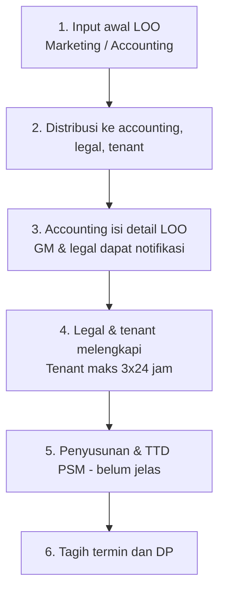
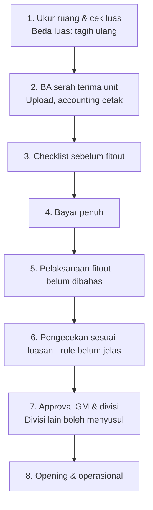

# Tenant Management System — Rangkuman Alur & Hasil Meeting

Dokumen ini merangkum catatan meeting aplikasi tenant (LOO sampai tenant beroperasi), penjelasan istilah, alur, perbandingan dengan praktik umum, dan daftar hal yang masih perlu diklarifikasi.

Legenda status: ✅ sudah ada di catatan meeting · ⚠️ belum jelas · ❓ belum dibahas

---

## 1. Gambaran umum

Aplikasi ini mengelola perjalanan tenant dari awal sampai beroperasi:

**Penawaran (LOO) → Kontrak (PSM) → Serah terima unit → Fitout → Pengecekan → Opening → Operasional**

Legal dan tenant digabung dalam satu aplikasi bernama **Tenant Management System**. Kontrak (PSM) juga dicatat di aplikasi.

## 2. Istilah penting

| Istilah | Arti |
|---|---|
| **LOO** (Letter of Offer) | Surat penawaran resmi ke calon tenant: unit, luas, harga sewa, service charge, masa sewa, termin/DP. Menjadi dasar semua tahap berikutnya. |
| **PSM** (Perjanjian Sewa Menyewa) | Kontrak resmi yang mengikat antara pengelola dan tenant. Disusun oleh legal berdasarkan LOO. |
| **Termin** | Pembayaran bertahap sesuai kesepakatan di LOO. |
| **DP** | Uang muka. Untuk fitout, DP minimal harus dibayar lebih dulu. |
| **Fitout** | Pekerjaan interior oleh tenant di unit kosong (dinding, lantai, plafon, lampu, dll). |
| **BA** (Berita Acara) serah terima | Dokumen resmi bahwa unit diserahkan ke tenant beserta kondisinya. |
| **IM** | Bukti fisik pengukuran luas (sesuai catatan meeting: accounting upload fisik IM sebagai bukti). |
| **Checklist** | Bukti tertulis bahwa suatu tahap sudah dicek dan disetujui. |
| **Opening** | Tenant mulai beroperasi/membuka toko. |

## 3. Peran dan hak akses

| Role | Akses / tugas |
|---|---|
| **Marketing** | Input awal LOO (bisa juga accounting) untuk didistribusikan ke legal, tenant, accounting. Tidak punya akses aplikasi, hanya menerima. |
| **Accounting** | Akses penuh. Mengisi informasi/data LOO. Menagih termin, mencetak BA, upload bukti fisik IM. |
| **Legal** | Akses penuh untuk tenancies. Hanya mengisi bagian LOO yang menjadi wewenangnya. |
| **Tenant** | Dibatasi: hanya melihat cover LOO, tidak boleh melihat kontrak. Mengisi data tenant sendiri. |
| **GM** | Menerima notifikasi/monitoring, menandatangani approval akhir. |

## 4. LOO sebagai satu dokumen, diisi bertahap

| Bagian | Diisi oleh | Isi (contoh) |
|---|---|---|
| A. Input awal | Marketing / accounting | Calon tenant, unit, data dasar |
| B. Detail komersial | Accounting | Luas, harga sewa, service charge, termin, DP |
| C. Bagian legal | Legal | Data legalitas, dasar penyusunan kontrak |
| D. Data tenant | Tenant | Data usaha, penanggung jawab, kontak |

Tiap bagian punya status sendiri (belum diisi → sedang diisi → selesai), sehingga notifikasi dan riwayat hambatan bisa dilacak.

## 5. Alur bagian 1: LOO sampai tagihan

```
1. Input awal LOO ............ Marketing / accounting ............ ✅
        ↓
2. Distribusi ke 3 pihak ..... Accounting, legal, tenant (cover)  ✅
        ↓
3. Accounting isi detail LOO . GM dan legal dapat notifikasi ..... ✅
        ↓
4. Legal & tenant melengkapi . Tenant dibatasi 3x24 jam .......... ✅
        ↓
5. Penyusunan & TTD PSM ...... Legal; urutan belum jelas ........ ⚠️
        ↓
6. Tagih termin dan DP ....... Accounting, sesuai LOO ............ ✅
```



## 6. Alur bagian 2: ukur ruang sampai opening

```
1. Ukur ruang & cek luas ..... Beda luas → tagih ulang .......... ✅
        ↓
2. BA serah terima unit ...... Diupload, accounting mencetak .... ✅
        ↓
3. Checklist sebelum fitout .. Harus lengkap dulu ................ ✅
        ↓
4. Bayar penuh ............... Setelah DP, dengan checklist ..... ✅
        ↓
5. Pelaksanaan fitout ........ Tenant dan kontraktor ............ ❓
        ↓
6. Pengecekan sesuai luasan .. Dikunci, rule masih dibuat ....... ⚠️
        ↓
7. Approval GM dan divisi .... Divisi lain boleh menyusul ....... ✅
        ↓
8. Opening & operasional ..... Renovasi pakai checklist fitout .. ✅
```



**Jika luas berbeda:** tenant input fisik, accounting upload fisik IM sebagai bukti, hasil masuk ke accounting, lalu tagih ulang.

## 7. Notifikasi dan aturan waktu

- LOO tidak dibuka dalam **1x10 jam kerja** → notifikasi ke GM (di luar jam kerja, dihitung besoknya).
- Accounting input → GM dan legal mendapat info.
- Input accounting **dikunci pukul 16.30**.
- Tenant diberi batas **3x24 jam** untuk mengirim/mengisi data.
- Data utama LOO diberi **timestamp**.
- **History perjalanan**: apa yang menghambat, apa yang belum, sampai legalitas selesai.
- **Reminder** untuk accounting (pembayaran/tagihan) dan reminder tiap divisi ke GM (monitoring).

## 8. Perbandingan: praktik umum vs hasil meeting

| Tahap umum | Di meeting | Catatan |
|---|---|---|
| LOO diisi bergantian | ✅ | Peran sudah jelas |
| Pembatasan akses tenant | ✅ | Hanya cover LOO, tanpa kontrak |
| SLA dan eskalasi | ⚠️ | Aksi setelah lewat batas waktu belum jelas |
| PSM (kontrak) | ⚠️ | Alur dan status PSM belum dibahas |
| Tagihan termin dan DP | ✅ | Sesuai LOO, DP minimal sebelum fitout |
| Ukur ruang dan tagih ulang | ✅ | Jelas |
| BA serah terima, checklist pra-fitout | ✅ | Isi form/checklist belum dirinci |
| Pelaksanaan fitout (izin kerja, pengawasan, deposit) | ❓ | Biasanya ada di praktik umum |
| Pengecekan akhir sebelum buka | ⚠️ | Kriteria rule belum jelas |
| Approval akhir | ✅ | GM TTD, divisi lain boleh menyusul |
| Operasional (tagihan rutin, perpanjangan) | ❓ | Hanya reminder tagihan dan renovasi |
| Handover akhir masa sewa | ❓ | Pengembalian unit belum disinggung |

**Garis besar:** alur pengisian LOO, hak akses, tagihan, ukur ruang, dan serah terima sudah kuat. Yang masih abu-abu: PSM, aksi setelah batas waktu, rule pengecekan, urutan PSM terhadap pembayaran. Belum disentuh: pelaksanaan fitout, operasional jangka panjang, pengembalian unit.

## 9. Pertanyaan untuk meeting lanjutan

**Legal**
- Kapan PSM disusun dan ditandatangani: sebelum atau sesudah DP dan serah terima?
- Status PSM yang dicatat di aplikasi (draft, review, ditandatangani, aktif, berakhir)?
- Apakah aplikasi hanya menyimpan data dan file PSM, atau juga membuat draft otomatis dari data LOO?
- Apakah tenant boleh melihat status kontrak (tanpa isinya)?

**Accounting**
- Berapa DP minimal untuk fitout: nominal tetap atau persentase termin?
- Bagaimana mekanisme tagih ulang setelah ukur ulang?
- Apa yang terjadi setelah input terkunci pukul 16.30 (bisa dibuka lagi oleh siapa)?

**GM / Operasional**
- Apa arti 1x10 jam kerja dan 3x24 jam: SLA dengan eskalasi otomatis atau sekadar reminder?
- Apa kriteria rule pengecekan setelah fitout "sesuai luasan"?
- Divisi mana yang boleh menyusul TTD setelah opening, dan batas waktunya?
- Bagaimana proses pelaksanaan fitout (izin kerja, pengawasan, deposit) dan pengembalian unit di akhir sewa?

---

*Catatan: bagian praktik umum adalah kerangka umum dunia properti dan bisa berbeda di tiap perusahaan. Bagian bertanda ⚠️ dan ❓ perlu dikonfirmasi ke pihak terkait.*
